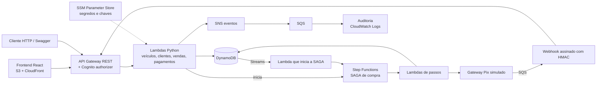
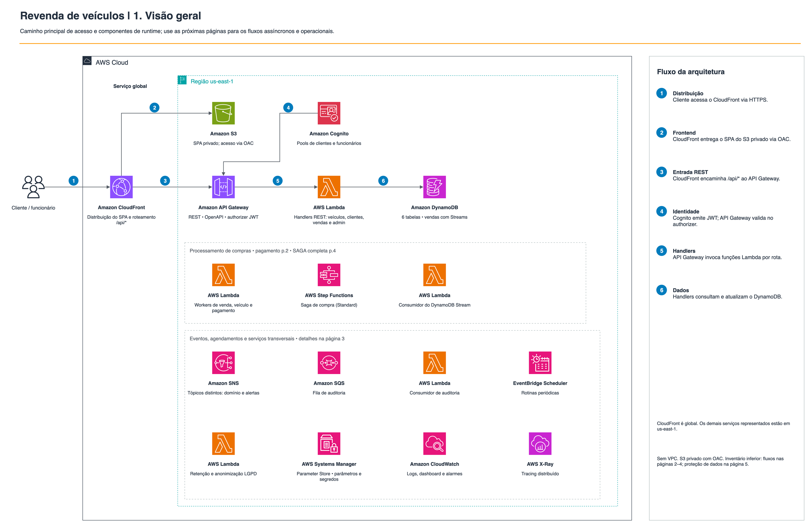
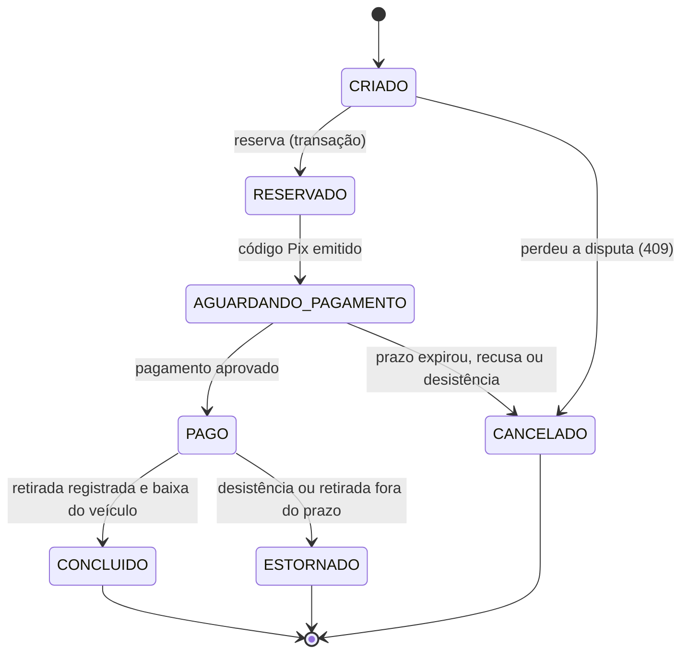

# Revenda de veículos — API serverless na AWS

API REST para uma plataforma de revenda de veículos: cadastro e edição de veículos, cadastro de compradores, listagens por preço e o processo de compra completo (reserva, pagamento, retirada e baixa no estoque), com tratamento de concorrência, falta de pagamento e desistência.

Projeto do **Tech Challenge SOAT — Fase 5** (pós-graduação em Arquitetura de Software, FIAP).

## Sumário

- [Entregáveis](#entregáveis)
- [Requisitos de negócio e onde estão atendidos](#requisitos-de-negócio-e-onde-estão-atendidos)
- [Escopo e limites](#escopo-e-limites)
- [Arquitetura](#arquitetura)
- [SAGA de compra](#saga-de-compra)
- [Segurança e dados pessoais](#segurança-e-dados-pessoais)
- [API](#api)
- [Frontend](#frontend)
- [Estrutura do repositório](#estrutura-do-repositório)
- [Executar localmente](#executar-localmente)
- [Como executar os testes](#como-executar-os-testes)
- [Custos: leia antes de implantar](#custos-leia-antes-de-implantar)
- [Passo a passo: do zero à demonstração](#passo-a-passo-do-zero-à-demonstração)
- [Segurança do repositório](#segurança-do-repositório)

## Entregáveis

| Entregável do enunciado | Documento | Resumo neste README |
|---|---|---|
| Enunciado oficial | [fase5-trabalho-reposicao-tech-challenge-soat.pdf](docs/deliverables/fase5-trabalho-reposicao-tech-challenge-soat.pdf) | Requisitos acadêmicos que orientam a solução |
| Desenho da arquitetura, com serviços serverless/gerenciados, justificativas e serviços de segurança | [architecture-design.pdf](docs/deliverables/architecture-design.pdf) | [Arquitetura](#arquitetura) |
| Relatório de segurança dos dados | [data-security-report.pdf](docs/deliverables/data-security-report.pdf) | [Segurança e dados pessoais](#segurança-e-dados-pessoais) |
| Relatório do tipo de SAGA e justificativa | [saga-report.pdf](docs/deliverables/saga-report.pdf) | [SAGA de compra](#saga-de-compra) |
| Código | Este repositório | [Estrutura do repositório](#estrutura-do-repositório) |

O PDF [tech-challenge-fase5.pdf](docs/deliverables/tech-challenge-fase5.pdf) reúne os três relatórios e os cinco diagramas em um só documento. O enunciado oficial também está em `docs/deliverables/`; é um arquivo separado desse pacote de entrega.

Os PDFs da entrega ficam versionados em `docs/deliverables/`. As fontes HTML estão em `docs/deliverables/src/` (regeneração: `python3 docs/deliverables/src/build.py`, com Google Chrome instalado). O código-fonte está em [github.com/Edufreitass/fase5-tech-challenge-soat](https://github.com/Edufreitass/fase5-tech-challenge-soat). Se o repositório estiver privado, o avaliador precisa receber acesso (ou o repositório deve ser tornado público antes da avaliação).

## Requisitos de negócio e onde estão atendidos

As colunas separam o código que implementa o requisito do teste automatizado que o verifica.

| Requisito | Como foi atendido | Implementação | Teste automatizado |
|---|---|---|---|
| Cadastrar veículo (marca, modelo, ano, cor, preço) | `POST /veiculos`, restrito a funcionários | `backend/src/vehicles/` | `backend/tests/unit/vehicles/` |
| Editar veículo | `PATCH /veiculos/{id}` com controle de versão (`If-Match`; sem ele, `428`) | `backend/src/vehicles/` | `backend/tests/unit/vehicles/` |
| Listar à venda, do mais barato ao mais caro | `GET /veiculos`, consulta ordenada no índice `gsi_status_preco` do DynamoDB | `backend/src/vehicles/adapters/dynamodb/` | `backend/tests/unit/vehicles/` |
| Listar vendidos, do mais barato ao mais caro | `GET /veiculos/vendidos` (funcionários), mesmo índice | idem | idem |
| Cadastrar compradores | `POST /clientes`: CPF válido, endereço e consentimento | `backend/src/customers/` | `backend/tests/unit/customers/` |
| Vender somente para cadastrados | A compra valida o cadastro completo (inclui RG) antes de reservar | `backend/src/sales/application/purchase.py` | `backend/tests/unit/sales/` |
| Processo completo: seleção → reserva → código de pagamento → pagamento → retirada → baixa | SAGA orquestrada ([detalhes](#saga-de-compra)) | `infra/workflows/purchase_saga.asl.json` | `backend/tests/unit/sales/test_saga.py` |
| Outro cliente reserva antes | Transação condicional no DynamoDB escolhe um vencedor; o perdedor recebe `409` | `backend/src/sales/` | `backend/tests/unit/sales/test_reservation.py` |
| Pagamento não efetuado | Prazo de espera (padrão 48 h); ao expirar, cancela a cobrança e libera o veículo | SAGA | `test_saga.py` |
| Cliente desiste em qualquer passo | `POST /vendas/{id}/desistencia`: libera o veículo e estorna se já houve pagamento. Depois da retirada, a desistência é rejeitada | SAGA | `test_saga.py` |
| Dados do cliente para emitir pagamento e documentação | Serviço de clientes guarda CPF, RG, CNH opcional, endereço e contato; dados sensíveis cifrados | `backend/src/customers/` | `backend/tests/unit/customers/` |

## Escopo e limites

- **Pagamento simulado.** O código Pix vem do stub do gateway (`backend/src/stubs/mock_gateway/`), sem integração bancária real. A equipe confirma ou recusa o pagamento pelo painel (ver o [passo a passo](#passo-a-passo-do-zero-à-demonstração)).
- **Documentação da retirada.** O sistema registra horário, protocolo e responsável. Não emite documento oficial nem integra órgão de trânsito.
- **Proteção de dados.** O projeto implementa controles técnicos. Bases legais e prazos de retenção exigem validação jurídica antes de uso real.
- **Ambiente.** A configuração versionada está com `destroy: true`: o pipeline executa a remoção do ambiente (nada fica rodando nem gera custo). Para publicar, configure `destroy: false` antes do `push`, seguindo o [passo a passo](#passo-a-passo-do-zero-à-demonstração). Um workflow verde de remoção não comprova a publicação nem a execução E2E.
- **Controles de segurança.** Apenas os listados em [Serviços de segurança](#serviços-de-segurança-e-justificativas) estão implementados; os demais estão [documentados, com a justificativa de custo](#controles-de-segurança-não-implementados-apenas-documentados).

## Arquitetura

A API segue **arquitetura hexagonal** por contexto (`vehicles`, `customers`, `sales`, `payments`): domínio e aplicação não dependem da AWS; os *adapters* (DynamoDB, SNS, Step Functions) ficam nas bordas. Um teste de arquitetura e o `import-linter` impedem essas dependências no CI. `backend/src/migration_runner/` executa as migrações declaradas em `backend/data_migrations/`; os nomes deixam explícito o papel de cada pasta.



Os cinco diagramas AWS (visão geral, pagamento e callback, eventos e operações, ciclo completo da compra, identidade e proteção de dados) estão em [docs/diagrams](docs/diagrams/). O arquivo editável é `arquitetura-aws-revenda.drawio`.



### Serviços e justificativas

| Serviço | Papel no projeto | Por que foi escolhido |
|---|---|---|
| API Gateway REST | Entrada única da API, contrato OpenAPI, throttling, authorizer Cognito | Interface gerenciada, sem servidor a operar |
| Lambda (Python 3.13, arm64) | Handlers HTTP e workers, uma role IAM por função | Paga por uso; arm64 reduz custo; escala sem administração |
| DynamoDB | Veículos, clientes, vendas, pagamentos, idempotência e gateway simulado | Escritas condicionais e transações resolvem a concorrência da reserva; índice com preço como *sort key* entrega a listagem ordenada sem ordenar em memória |
| Step Functions Standard | Orquestra a SAGA de compra | Esperas longas (dias), compensações explícitas e histórico por execução |
| Cognito | Dois *user pools*: clientes e funcionários (MFA obrigatório) | Autenticação gerenciada; separa populações com riscos distintos |
| SNS + SQS | Eventos de domínio, auditoria e entrega do webhook, com DLQ | Desacopla o que não deve bloquear o fluxo principal |
| DynamoDB Streams | Detecta a transição `CRIADO → RESERVADO` e inicia a SAGA | O início do fluxo nasce do dado persistido, sem publicar em dois lugares |
| EventBridge Scheduler | Varredura de vendas órfãs e rotina diária de retenção LGPD | Agendamento gerenciado, sem servidor de cron |
| SSM Parameter Store (SecureString) | Segredo do webhook e chave privada de criptografia | Segredos fora do código, cifrados com KMS gerenciado |
| CloudWatch e X-Ray | Logs, 9 métricas de negócio, 9 alarmes, painel e rastreamento | Observabilidade nativa e sem agentes |
| S3 privado + CloudFront | Hospeda o frontend com OAC e cabeçalhos de segurança | Site estático sem servidor |
| Terraform + GitHub Actions (OIDC) | Infraestrutura como código e entrega com credenciais temporárias | Ambiente reproduzível; sem chaves de longa duração no pipeline |

### Serviços de segurança e justificativas

| Serviço | Uso | Por quê |
|---|---|---|
| Cognito | Autenticação em dois *user pools*; MFA obrigatório para funcionários | A aplicação não guarda senhas; o MFA reduz o risco de uma conta de funcionário comprometida |
| API Gateway (authorizer Cognito e throttling) | Valida o token antes de executar a Lambda e limita a taxa de requisições | Rejeita na borda o que não está autenticado e reduz abuso |
| IAM (uma role por Lambda e *permissions boundary*) | Menor privilégio | Limita o dano se uma função for comprometida; só duas funções leem a chave privada de CPF, RG e CNH |
| SSM Parameter Store e KMS | Segredos e chave privada | Segredos fora do código e do repositório, cifrados em repouso |
| S3 privado e CloudFront (OAC e cabeçalhos de segurança) | Hospedagem do frontend | O bucket não tem acesso público; todo acesso passa pelo CloudFront |
| CloudWatch Logs, SNS e SQS | Trilha de auditoria com retenção de 5 anos | Permite saber quem acessou dados pessoais |
| OIDC do GitHub Actions | Credenciais temporárias no pipeline | Sem chaves AWS de longa duração |

### Controles de segurança não implementados (apenas documentados)

Os controles abaixo **não existem no código nem no Terraform**: foram deliberadamente deixados de fora por custo, porque o projeto é acadêmico e roda em conta pessoal. Eles são o caminho natural de evolução para produção. O [relatório de segurança](docs/deliverables/data-security-report.pdf) descreve o risco residual de cada ausência.

| Controle | O que protegeria | Por que não foi implementado (custo) | Mitigação atual |
|---|---|---|---|
| AWS WAF | Bloqueio de padrões de ataque web (injeção, bots, IPs maliciosos) na borda | Cobrança mensal fixa por Web ACL e por regra, mais por requisição inspecionada; não há cota gratuita | Throttling no API Gateway, validação de entrada, autenticação Cognito, cabeçalhos de segurança no CloudFront |
| Amazon GuardDuty | Detecção gerenciada de ameaças e atividade anômala na conta | Gratuito só durante o período de avaliação; depois cobra por volume de eventos analisados | Alarmes do CloudWatch, logs de auditoria da aplicação |
| AWS Security Hub | Consolidação de achados e verificação de padrões (CIS, FSBP) | Gratuito só na avaliação; depois cobra por verificação e por achado ingerido, e depende de AWS Config | Revisão de IaC, `bandit`, `pip-audit`, `gitleaks`, `zizmor` no CI |
| Amazon Macie | Descoberta de dados sensíveis em buckets S3 | Cobra por bucket monitorado e por dado inspecionado; o projeto não armazena dados pessoais em S3 (só o site estático) | Dados pessoais ficam no DynamoDB, com CPF/RG/CNH cifrados por campo |
| Chave KMS gerenciada pelo cliente (CMK) | Controle próprio de política, rotação e auditoria da chave | Cobra mensalidade por chave e por requisição de uso; segredos usam `alias/aws/ssm` (chave gerenciada pela AWS, sem custo adicional) | Cifra por campo (libsodium) com chave privada em SSM SecureString e leitura restrita a duas funções |
| DynamoDB PITR (recuperação para ponto no tempo) | Restauração após exclusão ou corrupção acidental | Cobrado por GB-mês de backup contínuo, fora do free tier | Tabelas, índices e dados iniciais são recriáveis por Terraform e migrações (vendas reais não são recuperáveis) |
| CloudTrail próprio (trail com entrega em S3) | Auditoria permanente de chamadas à API da AWS | Trail adicional implica armazenamento em S3 e, para eventos de dados, cobrança por evento | Histórico de eventos de gerenciamento padrão da conta (90 dias) e auditoria de aplicação (SNS → SQS → CloudWatch Logs) |

Os valores variam por região e mudam com o tempo; confirme nas páginas de preço da AWS antes de ativar qualquer item.

### Modelo de dados

Seis tabelas DynamoDB, definidas em `infra/terraform/`:

| Tabela | Conteúdo | Acessos principais |
|---|---|---|
| veículos | Marca, modelo, ano, cor, preço, status (`DISPONIVEL`, `RESERVADO`, `AGUARDANDO_RETIRADA`, `VENDIDO`, `INATIVO`) | Índice `gsi_status_preco`: listagens por status ordenadas por preço |
| clientes | Perfil, documentos cifrados, consentimentos | Por ID; unicidade de CPF e e-mail via HMAC |
| vendas | Venda, estado, histórico, snapshot do veículo | Por ID; índices por cliente e por estado |
| pagamentos | Cobrança, referência do gateway, estados | Por venda |
| idempotência | Chaves de operações já processadas | — |
| gateway simulado | Cobranças e estornos do Pix simulado | — |

## SAGA de compra

**Tipo escolhido: SAGA orquestrada**, implementada em AWS Step Functions Standard (`infra/workflows/purchase_saga.asl.json`, 34 estados).

**Por quê.** O fluxo tem sequência definida, esperas longas (pagamento e retirada) e compensações diferentes conforme o ponto da falha (antes ou depois de pagar). Um orquestrador concentra essas regras e prazos em um só lugar e registra o histórico de cada venda. Na coreografia, as mesmas regras ficariam espalhadas entre consumidores de eventos, o que dificulta responder "em que passo esta venda está e por quê". SNS e SQS continuam em uso apenas para auditoria, fora do caminho crítico.

**Antes da SAGA.** A API grava a venda como `CRIADO` e, em uma transação DynamoDB, reserva o veículo, cria o bloqueio do cliente e muda a venda para `RESERVADO`. O Stream detecta essa transição e inicia a execução, nomeada pelo `vendaId` para evitar duplicidade.



| Situação | Tratamento |
|---|---|
| Dois compradores disputam o mesmo veículo | Um vence; o outro recebe `409` e sua venda é cancelada |
| Pagamento não chega no prazo | Cancela a cobrança e libera o veículo. Se a aprovação venceu a corrida, estorna antes de liberar |
| Pagamento recusado | Libera o veículo e cancela a venda |
| Pagamento chega depois do cancelamento | Marcado como aprovado tardio e estornado |
| Desistência antes da retirada | A decisão é gravada antes de avisar a SAGA (impede retirada concorrente); libera o veículo e estorna se já pago |
| Retirada não ocorre no prazo (padrão 7 dias) | Se já houver retirada gravada, conclui; senão, estorna e libera |
| Falha temporária de um callback | Repetir a mesma confirmação reenvia o callback; os passos têm *retry* exponencial com *jitter* |

Não há transação ACID entre DynamoDB, Lambda, gateway e Step Functions. A consistência vem de condições de escrita, referências determinísticas (idempotência) e compensações. Falhas definitivas podem exigir reprocessamento administrativo (`POST /administracao/vendas/{id}/fluxo/reprocessamento`). Detalhes em [saga-report.pdf](docs/deliverables/saga-report.pdf).

## Segurança e dados pessoais

| Dado | Tratamento |
|---|---|
| CPF, RG, CNH | Cifrados por campo (*sealed box* X25519/libsodium). O CPF tem também HMAC para garantir unicidade. Respostas comuns os mascaram |
| Nome, e-mail, telefone, endereço | Protegidos por IAM, autorização e criptografia em repouso do DynamoDB; **sem** cifragem por campo |
| Senhas | Gerenciadas pelo Cognito; nunca passam pelo código da aplicação |
| Segredos e chave privada | SSM Parameter Store (SecureString). A chave privada só é lida em execução por `fn-clientes-interno` e `fn-lgpd-worker` |
| Auditoria | Eventos SNS → SQS → CloudWatch Logs (retenção de 5 anos); consulta em `GET /administracao/auditoria` |

Controles principais:

- **Autorização em duas camadas.** O API Gateway valida o token Cognito; os handlers verificam papel (cliente, vendedor, admin) e dono do recurso. `backend/tests/unit/test_authorization_matrix.py` exercita todas as rotas contra os quatro perfis (anônimo, cliente, vendedor, admin) e falha se uma rota nova não entrar na matriz.
- **Primeiro administrador.** Nenhuma conta administrativa é criada por script. O e-mail do dono é declarado na implantação (`admin_email`). A rota pública `POST /configuracao-inicial` só funciona enquanto não há administrador e só convida esse e-mail: a senha temporária chega apenas à caixa dele, então quem chama a rota não ganha acesso. Depois do primeiro administrador, a rota responde `409` e a equipe passa a ser convidada pelo painel.
- **Webhook de pagamento.** Assinatura HMAC, *timestamp*, validação de valor e processamento idempotente.
- **LGPD.** Consentimento versionado, exportação dos dados (`GET /clientes/meu-perfil/exportacao`), exclusão com anonimização (`DELETE /clientes/meu-perfil`) e rotina diária que anonimiza clientes inativos sem histórico de venda.

O [relatório de segurança](docs/deliverables/data-security-report.pdf) traz o inventário completo, as políticas de acesso e a tabela de riscos com mitigação e risco residual.

## API

O contrato completo está em [`backend/contracts/openapi.json`](backend/contracts/openapi.json), organizado por contexto de domínio e documentado em pt-BR. A proposta de limites, recursos e colaboração entre contextos está em [`docs/design-api-ddd.md`](docs/design-api-ddd.md). A Lambda que serve Swagger UI/OpenAPI está em `backend/src/api_docs/`; com o ambiente publicado, o Swagger UI fica em `<api_url>/docs`.

| Grupo | Rotas |
|---|---|
| Veículos | `GET/POST /veiculos`, `GET /veiculos/vendidos`, `GET/PATCH /veiculos/{id}`, `POST /veiculos/{id}/inativacao`, `POST /veiculos/{id}/reativacao`, `GET /gestao/veiculos` |
| Clientes | `POST /clientes`, `GET/PATCH/DELETE /clientes/meu-perfil`, `POST /clientes/meu-perfil/consentimentos`, `GET /clientes/meu-perfil/exportacao`, `GET /clientes/meu-perfil/vendas` |
| Vendas | `GET/POST /vendas`, `GET /vendas/{id}`, `POST /vendas/{id}/desistencia`, `POST /vendas/{id}/retirada`, `GET /vendas/{id}/documentacao` |
| Administração | `GET/POST /configuracao-inicial` (pública, só até existir o primeiro administrador), `/administracao/funcionarios`, `/administracao/auditoria`, `/administracao/sagas`, `/administracao/solicitacoes-lgpd`, rotação de segredos e reprocessamento de fluxos com falha |
| Simulador de pagamentos | `/_simulacao/pagamentos/*` (cobrança, cancelamento, estorno e simulação de pagamento) |

## Frontend

O enunciado pede a API; o frontend demonstra a integração. É uma SPA em `frontend/` (React, Vite, Tailwind), servida pelo CloudFront no mesmo domínio da API (`/api/*`).

| Perfil | O que faz |
|---|---|
| Visitante | Navega pelo catálogo e vê o detalhe dos veículos |
| Cliente | Cadastra-se, completa o perfil, reserva, copia o código Pix, acompanha a SAGA, desiste e exporta ou exclui seus dados |
| Funcionário | Cadastra e edita veículos, **simula o pagamento Pix**, registra a retirada |
| Administrador | Além do anterior, convida e gerencia a equipe |
| Primeiro acesso | Tela `/configuracao-inicial` envia o convite ao administrador declarado na implantação |

## Estrutura do repositório

```text
.github/
  actions/        preparação e build compartilhados de Python e frontend para CI/CD
  workflows/      CI, deploy e E2E
backend/
  src/            código por contexto: vehicles, customers, sales, payments,
                  admin, audit, api_docs (Swagger), shared, stubs/mock_gateway
  tests/          unit, contract, architecture, e2e, load
  contracts/      openapi.json
  data_migrations/ definições YAML de segredos, chave PII e veículos de demonstração
frontend/         SPA React (Vite, Tailwind), testes Jest e Playwright
infra/
  terraform/      bootstrap, envs/dev e módulos
  config/         dev.yml e schema
  workflows/      purchase_saga.asl.json (definição AWS Step Functions)
docs/
  deliverables/   enunciado, relatórios e pacote de entrega em PDF
  diagrams/       diagramas AWS (.drawio e PNG)
  README.md       índice da documentação
```

O `pyproject.toml` permanece na raiz como configuração Python do monorepo: Ruff, mypy, pytest, cobertura e import-linter usam caminhos de `backend/`, e os comandos do README e da CI são executados da raiz. Movê-lo para `backend/` exigiria mudar esses pontos sem tornar a estrutura mais clara.

O frontend mantém `pages/` para composição de rotas e `features/` para telas e fluxos de domínio (dashboard e perfil). Utilitários transversais em `lib/` são separados por papel (`hooks/`, `formatters/`, `validators/`) ou domínio (`catalog/`, `vehicles/`); a estrutura de features não é duplicada em outro padrão.

## Executar localmente

O backend é composto por funções Lambda atrás de um API Gateway, então **não há um servidor da API para subir na máquina**: localmente ele é validado pela suíte de testes, que emula DynamoDB, Cognito, SSM, SNS e SQS com o Moto (nada é cobrado e não é preciso conta AWS). O frontend sobe localmente e pode apontar para uma API já publicada.

**Pré-requisitos:** Python 3.13, [uv](https://docs.astral.sh/uv/) (opcional, mais rápido; há alternativa com `venv` abaixo), Node.js 20 ou superior com npm, e Git.

**1. Backend: ambiente virtual e testes**

```bash
uv venv --python 3.13 .venv
uv sync --group dev
.venv/bin/pytest
```

Sem o `uv`, use `python3.13 -m venv .venv`, ative o ambiente e rode `python -m pip install --group dev` (instruções completas, inclusive para Windows, em [Como executar os testes](#como-executar-os-testes)). Resultado esperado: todos os testes aprovados e cobertura acima de 80%.

**2. Frontend: dependências, testes e execução**

```bash
cd frontend
npm ci
npm run test:ci
npm run dev
```

O `npm run dev` abre o site em `http://localhost:5173`. Sem uma API, o catálogo mostra o estado de erro de rede (comportamento esperado). Para ver o fluxo completo, publique o ambiente ([Passo a passo](#passo-a-passo-do-zero-à-demonstração)) e informe os dados dele por variáveis de ambiente (nunca em arquivos versionados):

```bash
API_ALVO="<url da API>" \
CLIENT_ID_CLIENTES="<id>" DOMINIO_CLIENTES="<dominio>" \
CLIENT_ID_FUNCIONARIOS="<id>" DOMINIO_FUNCIONARIOS="<dominio>" \
npm run dev
```

Os valores saem do resumo do deploy (GitHub Actions) ou do `config.json` do site publicado.

## Como executar os testes

Os testes do backend rodam localmente, sem AWS (DynamoDB e demais serviços são emulados pelo Moto). Requisitos: **Python 3.13** e, para o frontend, **Node.js** com npm. Os comandos abaixo funcionam em Linux, macOS e Windows; só a criação do ambiente virtual muda.

Criar o ambiente virtual e instalar as dependências:

**Linux e macOS (bash ou zsh)**

```bash
python3.13 -m venv .venv
source .venv/bin/activate
python -m pip install --upgrade pip
python -m pip install --group dev
```

**Windows (PowerShell)**

```powershell
py -3.13 -m venv .venv
.venv\Scripts\Activate.ps1
python -m pip install --upgrade pip
python -m pip install --group dev
```

Se o PowerShell bloquear o script de ativação, execute `Set-ExecutionPolicy -Scope CurrentUser RemoteSigned` uma vez. No Prompt de Comando (cmd), ative com `.venv\Scripts\activate.bat`.

Com o ambiente ativado, os comandos são iguais nos três sistemas:

```text
pytest
ruff check .
ruff format --check .
mypy backend/src
```

O `pytest` roda testes unitários, de integração, de contrato e de arquitetura, e falha se a cobertura ficar abaixo de 80%. O contrato de arquitetura hexagonal é verificado com `lint-imports`, que precisa de `backend/src` no caminho de módulos:

| Sistema | Comando |
|---|---|
| Linux e macOS | `PYTHONPATH=backend/src lint-imports` |
| Windows (PowerShell) | `$env:PYTHONPATH="backend/src"; lint-imports` |

Frontend (igual nos três sistemas):

```text
cd frontend
npm ci
npm run test:ci
npm run build
```

Para atualizar o contrato OpenAPI depois de alterar rotas, defina `ATUALIZAR_OPENAPI=1` e rode `pytest backend/tests/contract` (Linux e macOS: `ATUALIZAR_OPENAPI=1 pytest backend/tests/contract`; PowerShell: `$env:ATUALIZAR_OPENAPI=1; pytest backend/tests/contract`).

Os testes E2E e de carga (`backend/tests/e2e`, `backend/tests/load` e o Playwright em `frontend/`) exigem um ambiente publicado e credenciais AWS, e **geram custo** (ver abaixo).

Validação local em **05/11/2026**: 555 testes do backend aprovados, cobertura de 95,12% no recorte configurado; 156 testes unitários do frontend e quatro testes locais de navegador aprovados. Também passaram lint, formatação e tipagem do backend (`ruff`, `mypy`), `import-linter`, `bandit`, e lint, tipagem e build do frontend. Os testes locais de navegador usam respostas de rede simuladas e não comprovam integração com a AWS.

Para repetir os testes locais de navegador, execute `npm run test:browser` em `frontend/` depois de instalar o Chromium com `npx playwright install chromium`. Como alternativa, use `E2E_CHANNEL=chrome` com o Google Chrome instalado.

## Custos: leia antes de implantar

**Em contas dentro do Free Tier, com o consumo dentro das cotas gratuitas, a solução, em princípio, não gera custo. Fora disso, haverá custo, e ele precisa ser analisado com cuidado, principalmente ao executar testes de carga ou E2E.** O alerta de orçamento criado pelo bootstrap apenas notifica; não impede cobrança.

O que a AWS declara como gratuito para os serviços centrais (consulta às páginas oficiais em 27/10/2026; confirme os valores vigentes antes de implantar):

| Serviço | Cota gratuita | Observação neste projeto |
|---|---|---|
| Lambda | 1 milhão de requisições e 400.000 GB-s por mês | — |
| DynamoDB (capacidade provisionada) | 25 RCU, 25 WCU e 25 GB | As tabelas e índices de `dev.yml` somam exatamente 25 RCU e 25 WCU. Qualquer outra tabela provisionada na mesma conta e região passa do limite |
| Step Functions Standard | 4.000 transições de estado por mês | Cada compra percorre vários dos 34 estados da SAGA; testes de carga esgotam a cota rapidamente |
| Cognito | 10.000 usuários ativos por mês | — |
| API Gateway REST | 1 milhão de chamadas por mês, **só nos primeiros 12 meses** | — |

Contas criadas a partir de 15/07/2025 usam o **plano gratuito**: até US$ 200 em créditos, válido por 6 meses ou até os créditos acabarem, e sem cobrança enquanto não houver upgrade para o plano pago. Para os demais serviços (CloudWatch, X-Ray, CloudFront, S3, SNS, SQS, EventBridge e SSM), consulte a página de preços de cada um.

Para limitar o gasto: use `destroy: true` ao terminar, execute testes de carga em janelas curtas e acompanhe o consumo no console de cobrança.

Fontes: [Step Functions](https://aws.amazon.com/step-functions/pricing/), [Cognito](https://aws.amazon.com/cognito/pricing/), [Lambda](https://aws.amazon.com/lambda/pricing/), [DynamoDB](https://aws.amazon.com/dynamodb/pricing/provisioned/), [API Gateway](https://aws.amazon.com/api-gateway/pricing/), [plano gratuito](https://aws.amazon.com/about-aws/whats-new/2025/07/aws-free-tier-credits-month-free-plan/).

## Passo a passo: do zero à demonstração

Ao final, você terá o ambiente publicado na AWS e uma compra completa feita pela plataforma. Leia antes a seção [Custos](#custos-leia-antes-de-implantar). Para validar o código sem AWS, use [Como executar os testes](#como-executar-os-testes).

O bootstrap usa dois comandos e o envio do código, cinco de Git, uma única vez. O deploy em si é feito pelo GitHub Actions.

### Preparar

1. Instale: AWS CLI v2, Terraform 1.16 ou superior, Git e GitHub CLI (`gh`).
2. Crie um usuário IAM para o deploy. Não use a conta raiz (*root*): ela só serve para esta etapa.
   - No console da AWS, abra **IAM → Users → Create user**.
   - Dê um nome, por exemplo `revenda-deploy`. Não marque acesso ao console.
   - Em **Permissions**, escolha **Attach policies directly** e marque `AdministratorAccess`. O bootstrap cria roles, provedor OIDC, bucket e orçamento, então precisa de permissão ampla.
   - Abra o usuário criado, vá em **Security credentials → Create access key**, escolha **Command Line Interface (CLI)** e copie o *Access key ID* e o *Secret access key*.
3. Configure o AWS CLI com esse usuário:

   ```text
   aws configure --profile meu-perfil
   ```

   Informe o *Access key ID*, o *Secret access key*, a região `us-east-1` e o formato `json`.

4. Teste a conexão:

   ```text
   aws sts get-caller-identity --profile meu-perfil
   ```

   O campo `Arn` deve terminar em `user/revenda-deploy`. Se terminar em `:root`, você está usando a conta raiz: não continue, repita os passos 2 e 3.

5. Entre no GitHub: `gh auth login`.
6. Copie `infra/terraform/bootstrap/terraform.tfvars.example` para `terraform.tfvars` (ignorado pelo Git) e preencha os valores:

   | Variável | O que colocar |
   |---|---|
   | `admin_email` | Seu e-mail: recebe o convite do primeiro administrador |
   | `alertas_email` | Seu e-mail: recebe alarmes e o alerta de orçamento |
   | `aws_profile` | O perfil criado no passo 3 (`meu-perfil` no exemplo) |
   | `github_token` | O resultado do comando `gh auth token` (ou exporte `TF_VAR_github_token`; não o escreva em arquivos versionados) |
   | `github_owner` | Seu usuário do GitHub |
   | `github_repositorio` | O nome do repositório que será criado |
   | `github_criar_repositorio` | Opcional. `true` (padrão) cria o repositório; `false` usa um existente e vazio, sem gerenciá-lo |
   | `github_visibilidade` | Opcional. `"private"` (padrão) ou `"public"` |

### Criar a base e enviar o código

7. Rode o bootstrap, que cria o repositório, o bucket de estado, as roles do pipeline, o alerta de orçamento e as variáveis do GitHub Actions. Confirme com `yes` quando o Terraform pedir. Ao final, ele mostra o `repositorio_url`.

   ```text
   terraform -chdir=infra/terraform/bootstrap init
   terraform -chdir=infra/terraform/bootstrap apply
   ```

   O estado do bootstrap fica em `infra/terraform/bootstrap/terraform.tfstate`. Não o apague: ele permite alterar ou destruir o bootstrap depois.

   Depois do bootstrap, o pipeline usa credenciais temporárias (OIDC) e não precisa da chave do usuário IAM. Você pode desativá-la no IAM e reativá-la só para alterar ou destruir o bootstrap.

8. Em `infra/config/dev.yml`, configure `destroy: false` para publicar o ambiente. Envie o código, trocando `<repositorio_url>` pelo valor mostrado no passo 7. O `push` para `main` dispara o pipeline:

   ```text
   git init -b main
   git add .
   git commit -m "Entrega inicial"
   git remote add origin <repositorio_url>
   git push -u origin main
   ```

   Se usou um repositório existente que não está vazio, faça `git pull origin main --allow-unrelated-histories` antes do `push`.

   Para este projeto, o repositório remoto já existe e está vazio (`https://github.com/Edufreitass/fase5-tech-challenge-soat`). Nesse caso, no passo 6 use `github_criar_repositorio = false`, `github_repositorio = "fase5-tech-challenge-soat"` e, no `git remote add`, a URL acima.

### Acompanhar o deploy

9. No GitHub, abra o repositório, depois **Actions** e a execução **Deploy na AWS**.
10. Espere o job **Publicar o ambiente** ficar verde. Ele aplica a infraestrutura com o Terraform, carrega os dados iniciais, publica o frontend e executa um teste rápido.
11. Abra o resumo da execução (**Summary**): ele traz a URL do site e da API.

### Primeiro acesso

12. Abra a URL do site e clique em **Entrar**.
13. Escolha **Sou funcionário** e clique em **Primeira vez na loja? Configure o administrador**.
14. Clique em **Enviar convite ao administrador**. O Cognito envia uma senha temporária ao e-mail `admin_email`.
15. Volte ao login de funcionário e entre com o e-mail e a senha temporária.
16. Defina a nova senha e configure o MFA (aplicativo autenticador).

A tela de configuração inicial deixa de aceitar convites depois do primeiro. Os demais funcionários são convidados na aba **Equipe** do painel.

### Demonstração

17. **Veículos.** No painel, aba **Veículos**: veja os 20 veículos de demonstração por preço crescente, cadastre um e edite outro.
18. **Cliente.** Em outra janela anônima, entre em **Sou cliente** e crie a conta (autocadastro). Complete o perfil: o RG é exigido para comprar.
19. **Reserva.** Como cliente, abra um veículo e reserve. O mesmo veículo para outro cliente retorna `409`.
20. **Pagamento.** O cliente vê o código Pix na compra. No painel do funcionário, abra **Vendas**, filtre por *Aguardando pagamento* e clique em **Simular pagamento**, depois em **Aprovar pagamento**. Para testar a falta de pagamento, não aprove e deixe o prazo expirar.
21. **Retirada.** Em **Vendas**, filtre por *Pago* e clique em **Registrar retirada**. A venda vai a `CONCLUIDO` e o veículo a `VENDIDO`.
22. **Desistência.** Antes da retirada, o cliente pode clicar em **Desistir da compra**: o veículo é liberado, com estorno se já houve pagamento.

O mesmo roteiro pode ser feito pelo Swagger (`<url da API>/docs`); a simulação de pagamento é `POST /_simulacao/pagamentos/cobrancas/{transacao_id}/simular`.

### Encerrar

23. Em `infra/config/dev.yml`, troque `destroy: false` por `destroy: true`.
24. Faça *commit* e *push* para `main`. O pipeline executa o `terraform destroy`.
25. Confira no console da AWS se nada ficou para trás. O repositório e o bucket de estado do bootstrap continuam; para removê-los, use `terraform -chdir=infra/terraform/bootstrap destroy`.

## Segurança do repositório

O repositório foi preparado para ser público:

- **Nenhum segredo no código.** Não há chaves de acesso, senhas, tokens, IDs de conta AWS nem e-mails reais versionados. Segredos do webhook e a chave privada de CPF/RG/CNH são gerados na implantação e ficam no SSM Parameter Store (SecureString).
- **Arquivos sensíveis ignorados pelo Git:** `terraform.tfvars`, `*.tfstate`, `.env*` e `.terraform/`. Apenas o modelo `terraform.tfvars.example` (com valores fictícios) é versionado.
- **Pipeline sem chaves de longa duração.** O GitHub Actions assume uma role AWS por OIDC; os ARNs das roles ficam em *variables* do repositório, criadas pelo bootstrap, não no código.
- **Senhas de teste efêmeras.** Os testes E2E geram senhas aleatórias a cada execução (ou usam `E2E_SENHA` e `E2E_SENHA_TEMPORARIA`, se definidas).
- **Varredura contínua.** O CI executa `gitleaks` (segredos), `bandit` e `pip-audit` (Python), `npm audit` e `zizmor` (workflows).
- Os e-mails e CPFs que aparecem em testes são fictícios.

Antes de tornar o repositório público, faça uma última verificação do histórico (`gitleaks detect`) e remova qualquer valor real que tenha sido commitado por engano.
